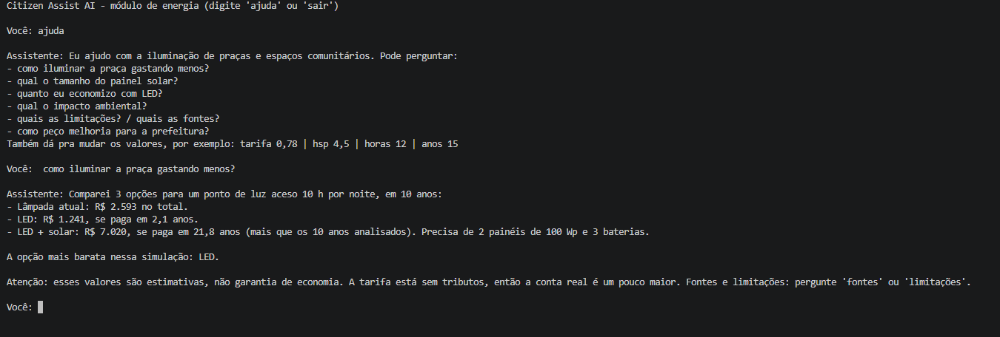
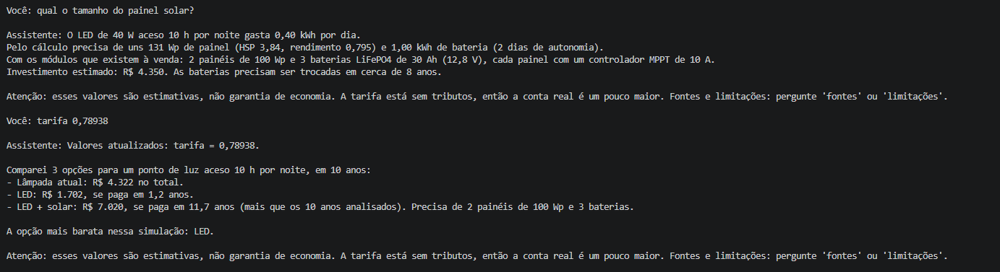
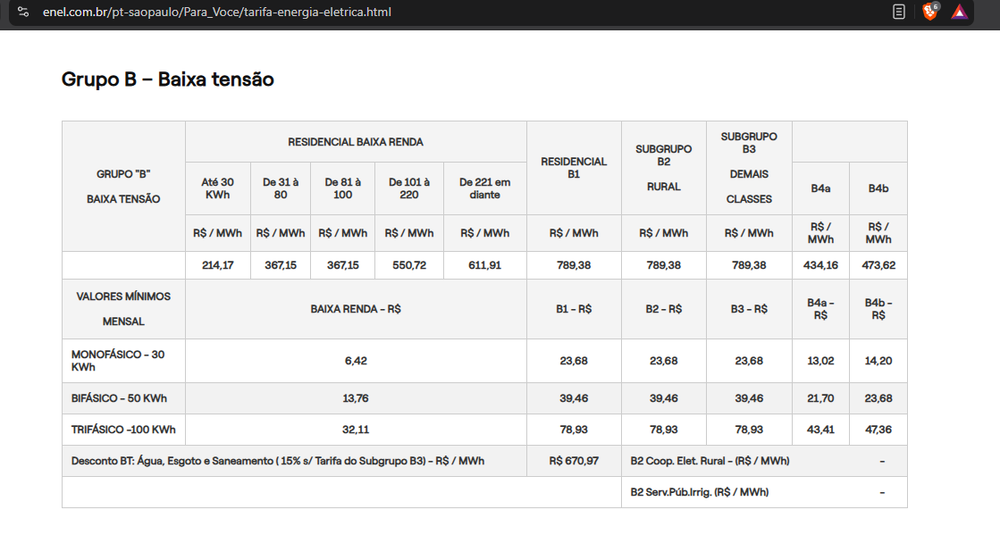
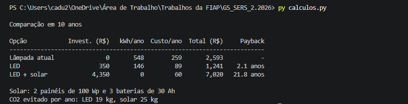

# Citizen Assist AI: módulo de energia (iluminação de praças)

Global Solution 2026/2, Ciência da Computação (1CC). Contribuição da disciplina **Soluções em Energias Renováveis e Sustentáveis** para o assistente Citizen Assist AI. O tema do nosso grupo é **segurança pública**.

## 1. Integrantes

| Nome completo | RM |
|---|---|
| Carlos Eduardo Affonso | 569676 |
| Igor Massone Monteiro | 573853 |

## 2. Público e problema

O público são moradores, associações de bairro e administradores de praças e espaços comunitários da cidade de São Paulo.

A necessidade de energia que escolhemos foi **manter a iluminação da praça à noite gastando pouco**. Iluminação pública pode ajudar na sensação de segurança, então quem cuida desses espaços quer deixar tudo bem iluminado, mas a conta de luz e a manutenção pesam. Nós não afirmamos que mais luz reduz o crime, porque os estudos mostram resultados diferentes dependendo do lugar (ver referências 7 e 8). O foco do módulo é a energia: quanto gasta, quanto custa e qual opção compensa.

Para o cálculo usamos **um ponto de luz** aceso das **19h às 5h (10 horas por noite)**. Esse horário foi uma escolha do grupo, e a noite em São Paulo costuma ser mais longa que isso.

## 3. O que o assistente faz

O usuário pergunta em linguagem normal e o assistente responde com base nos cálculos. Ele consegue:

- comparar três opções (lâmpada atual, LED e LED com painel solar) para o mesmo ponto de luz e o mesmo período;
- calcular o tamanho do sistema solar (painéis e baterias);
- mostrar custo total, tempo para a economia pagar o investimento (payback) e CO2 evitado;
- explicar como pedir melhoria de iluminação para a prefeitura;
- informar limitações e fontes em toda resposta;
- recalcular se o usuário mudar a tarifa, o HSP, as horas por noite ou os anos (exemplo: `tarifa 0,78 hsp 4,5 anos 15`).

>  Terminal com o assistente respondendo "como iluminar a praça gastando menos?".
>
> 

> Terminal com o assistente respondendo "qual o tamanho do painel solar?" e a pergunta com mudança de valores (ex.: `tarifa 0,78938`).
>
> 

## 4. Como rodar

Precisa só do Python 3.9 ou mais novo, sem instalar nada.

```bash
cd src
python calculos.py        # mostra a tabela de comparação
python assistente.py      # conversa com o assistente (digite "ajuda" ou "sair")
python assistente.py "qual o tamanho do painel solar?"
```

Para integrar no assistente principal, é só importar a função `responder` do arquivo `assistente.py`.

## 5. Estrutura do repositório

```
README.md
entrega.txt
src/
  calculos.py          contas e comparação das opções
  assistente.py        perguntas e respostas
docs/
  roteiro_video.md
  testes_usuarios.md   testes com usuários e ajustes
  img/                 prints usados neste README
```

## 6. Como calculamos

| O que | Conta |
|---|---|
| Consumo anual (kWh) | potência (kW) × horas por noite × 365 |
| Custo de energia por ano | kWh × tarifa |
| Rendimento do sistema solar | controlador × bateria × correção do módulo × cabos |
| Painel necessário (Wp) | energia por dia ÷ (HSP × rendimento) |
| Bateria necessária (Wh) | energia por dia × dias de autonomia ÷ profundidade de descarga |
| Número de painéis e baterias | necessário ÷ tamanho do módulo, arredondado para cima |
| Custo total no período | investimento + (energia + manutenção) × anos + troca das baterias |
| Payback | investimento ÷ (custo por ano da lâmpada atual − custo por ano da opção) |
| CO2 evitado | (kWh da lâmpada atual − kWh da opção) × fator de emissão |

As baterias são trocadas a cada 8 anos. Em 10 anos entra uma troca.

## 7. Dados usados

Cada dado tem um tipo: **Datasheet** (ficha do fabricante), **Orçamento** (preço de mercado), **Oficial** (fonte do governo ou da distribuidora), **Premissa** (escolha nossa), **Calculado** ou **Estimado** (valor que não conseguimos conferir direto na fonte).

| Dado | Valor | Unidade | Tipo | Origem |
|---|---|---|---|---|
| Potência da lâmpada atual | 150 | W | Datasheet | Vapor de sódio alta pressão com reator, Philips NAV-T / OSRAM Vialox (seção 11) |
| Potência do LED | 40 | W | Datasheet | Ilumatic / Ourolux, linha pública (seção 11) |
| Horas por noite | 10 | h | Premissa | Acesa das 19h às 5h |
| Período da comparação | 10 | anos | Premissa | Prazo comum para avaliar investimento |
| Tarifa | 0,47362 | R$/kWh | Oficial | Enel SP, REH 3.596/2026, vigente desde 04/07/2026, classe B4b (iluminação pública): TUSD R$ 283,45/MWh + TE R$ 190,17/MWh. **Sem tributos** |
| Fator de emissão | 0,0461 | kg CO2/kWh | Estimado | Média anual do SIN em 2025 segundo o MCTI/SIRENE. Não conseguimos abrir a planilha do MCTI, então o valor veio de fontes que citam o MCTI |
| HSP (sol pleno) | 3,84 | h/dia | Estimado | Não conseguimos confirmar no CRESESB SunData. Valor adotado pelo grupo para São Paulo (pior mês, plano inclinado), usado como estimativa |
| Rendimento do sistema solar | 0,795 | – | Calculado | Tabela abaixo |
| Autonomia da bateria | 2 | dias | Premissa | Para dias nublados |
| Profundidade de descarga | 0,80 | – | Datasheet | Bateria LiFePO4 (seção 11) |
| Tensão do sistema | 12,8 | V | Datasheet | Bateria LiFePO4 (seção 11) |
| Luminária LED instalada | 350 | R$ | Orçamento | Seção 11.2 |
| Painel de 100 Wp | 350 | R$ | Orçamento | R$ 3,50/Wp, seção 11.2 |
| Bateria LiFePO4 de 384 Wh | 690 | R$ | Orçamento | Seção 11.2 |
| Controlador MPPT 10 A (um por painel) | 380 | R$ | Orçamento | Seção 11.2 |
| Poste, braço e montagem | 820 | R$ | Orçamento | Estrutura de R$ 1.200 menos o controlador (seção 11.2) |
| Vida da bateria | 8 | anos | Datasheet | 3.000 ciclos, cerca de 8 anos |
| Manutenção por ano (LED / solar) | 20 / 60 | R$ | Orçamento | Seção 11.2 |

**Rendimento do sistema solar:**

| Parte | Fator | Origem |
|---|---|---|
| Controlador MPPT | 0,98 | Datasheet EPEVER Tracer AN |
| Bateria (ida e volta) | 0,92 | Datasheet do fabricante (o manual do CRESESB usa 0,95 como padrão, p. 131) |
| Correção do módulo (poeira, conexões, degradação) | 0,90 | Manual de Engenharia FV, CRESESB/CEPEL (2004), módulo cristalino, p. 135 |
| Cabos | 0,98 | Manual de Engenharia FV, p. 131 |
| **Total** | 0,98 × 0,92 × 0,90 × 0,98 = **0,795** | |

Não colocamos a perda por temperatura separada, porque o manual trata a temperatura pela tensão do módulo e não como fator de energia.

>  Página da Enel SP com a tabela de tarifas da REH 3.596/2026, mostrando a linha "Iluminação Pública (B4b)".
>
> 

## 8. Resultados

Comparação para um ponto de luz, 10 horas por noite, 10 anos (tarifa B4b sem tributos):

| Opção | Investimento | Custo por ano | Total em 10 anos | Payback | CO2 evitado por ano |
|---|---|---|---|---|---|
| Lâmpada atual | R$ 0 | R$ 259 | R$ 2.593 | – | – |
| LED | R$ 350 | R$ 89 | R$ 1.241 | 2,1 anos | 19 kg |
| LED + solar (2 painéis, 3 baterias) | R$ 4.350 | R$ 60 | R$ 7.020 | 21,8 anos | 25 kg |

> Terminal com o resultado de `python calculos.py`.
>
> 

Se a conta fosse paga como classe B3 (R$ 0,78938/kWh, também sem tributos), os totais seriam R$ 4.322 (lâmpada atual), R$ 1.702 (LED) e R$ 7.020 (solar), com payback de 1,2 ano para o LED e 11,7 anos para a solar. Ou seja, mesmo com a tarifa mais cara a solar não se paga nos 10 anos.

## 9. Recomendações e justificativas

**Custo.** O LED é o mais barato porque corta cerca de 73% do consumo gastando só R$ 350 por ponto. A solar custa muito mais por causa das 3 baterias e dos 2 painéis, e a bateria ainda precisa ser trocada no meio do período.

**Viabilidade.** Onde já existe rede elétrica, a troca por LED é simples e rápida. A solar precisa de espaço para os painéis, de lugar sem sombra e de manutenção (limpeza e troca de bateria). Ela faz sentido em praça ou espaço comunitário **sem rede elétrica** ou onde o custo de levar a rede for alto, porque aí a comparação com a lâmpada atual deixa de existir.

**Impacto ambiental.** O ganho em CO2 é pequeno (19 a 25 kg por ano por ponto) porque a energia elétrica do Brasil já tem muita fonte renovável. Também não contamos a fabricação e o descarte de painéis e baterias, que têm impacto.

**Recomendação do assistente.** Com rede elétrica, trocar por LED. Sem rede, considerar a luminária solar. Em praça pública, pedir à prefeitura (COSIP). Em espaço comunitário, falar com quem cuida do local.

## 10. Limitações

- Os valores são estimativas e **não garantem** economia nem geração de energia.
- A tarifa não inclui tributos (ICMS e PIS/COFINS), então a conta real é maior e o retorno do investimento é um pouco mais rápido do que calculamos.
- Não conseguimos confirmar o HSP (3,84) no SunData nem abrir a planilha do MCTI do fator de emissão. Usamos o valor adotado pelo grupo e fontes que citam o MCTI, então esses dois números são estimativas.
- O custo de poste e montagem (R$ 820) foi mantido para 2 painéis e 3 baterias, mas o orçamento real pode ser maior.
- Dois controladores ligados no mesmo banco de baterias é uma premissa que precisa ser confirmada com o fornecedor.
- Não colocamos a perda por temperatura do painel nem reajuste de tarifa ao longo dos anos.
- Dias nublados seguidos podem esgotar a bateria, e sombra reduz a geração.
- Em via pública a instalação depende da prefeitura, e em espaço comunitário, de autorização.
- Mais iluminação não garante menos crime.

## 11. Datasheets e orçamentos

Para as premissas do cálculo consultamos datasheets de fabricantes e orçamentos médios de mercado no Brasil (referência 2024/2025).

### 11.1 Especificações técnicas

| Componente | O que usamos | Especificação | Fonte |
|---|---|---|---|
| Luminária atual | Potência | 150 W (vapor de sódio alta pressão com reator) | Philips NAV-T / OSRAM Vialox |
| Luminária LED | Potência e eficiência | 40 W, 130 lm/W, FP > 0,95, vida útil 50.000 h | Ilumatic / Ourolux, linha pública |
| Painel solar | Potência de pico | 100 Wp monocristalino, eficiência 20,4% | RESUN / Canadian Solar, linha off-grid |
| Bateria de lítio | Capacidade e vida útil | LiFePO4 12,8 V 30 Ah (384 Wh), DoD 80%, 3.000 ciclos (cerca de 8 anos) | Unipower / Lifepo4 Eletrônica |
| Controlador de carga | Tipo e eficiência | MPPT 10 A, eficiência 98% | EPEVER, linha Tracer AN |

### 11.2 Custos

**A. LED**

- Luminária LED 40 W pública com tomada NEMA: R$ 230
- Braço de fixação em poste e conectores: R$ 70
- Mão de obra de substituição em altura: R$ 50
- **Total instalada: R$ 350**
- Manutenção e limpeza: R$ 20 por ano

**B. LED com sistema solar (um conjunto de referência)**

- Painel de 100 Wp: R$ 350 (R$ 3,50 por Wp)
- Bateria LiFePO4 12,8 V 30 Ah (384 Wh): R$ 690 (cerca de R$ 1.800 por kWh)
- Controlador MPPT com caixa IP66: R$ 380
- Poste, braço solar e montagem: R$ 820
- Estrutura (controlador + poste e montagem): R$ 1.200
- Conjunto de referência (1 painel + 1 bateria): R$ 2.240
- Troca de bateria (a cada 8 anos): R$ 690 por bateria
- Manutenção (limpeza do painel e inspeção): R$ 60 por ano

### 11.3 Dimensionamento para a nossa carga

O conjunto de referência (100 Wp e 384 Wh) não aguenta a luminária de 40 W por 10 horas: o painel gera cerca de 305 Wh por dia (100 × 3,84 × 0,795) e a carga é de 400 Wh por dia, e a bateria útil (384 × 0,80 ≈ 307 Wh) dá menos de um dia de autonomia. Por isso calculamos o necessário e arredondamos para os módulos que existem:

| Item | Conta | Resultado |
|---|---|---|
| Consumo por dia | 0,040 kW × 10 h | 0,40 kWh |
| Painel necessário | 0,40 kWh ÷ (3,84 × 0,795) | cerca de 131 Wp, então 2 painéis de 100 Wp |
| Bateria necessária | 0,40 kWh × 2 dias ÷ 0,80 | 1,00 kWh, então 3 baterias de 384 Wh (1,15 kWh) |
| Controladores | 1 por painel (100 Wp ÷ 12,8 V ≈ 7,8 A, cabe nos 10 A) | 2 |
| Geração por dia | 200 Wp × 3,84 × 0,795 | cerca de 611 Wh (carga: 400 Wh) |
| Energia útil guardada | 1.152 Wh × 0,80 | cerca de 922 Wh (para 2 dias precisa de 800 Wh) |
| Investimento | 2 × (350 + 380) + 3 × 690 + 820 | **R$ 4.350** |
| Troca das baterias (ano 8) | 3 × 690 | R$ 2.070 |

## 12. Referências

Data de consulta das páginas: 13/11/2026.

1. Enel SP. Tarifa de energia elétrica, Resolução Homologatória ANEEL nº 3.596, de 30/06/2026. https://www.enel.com.br/pt-saopaulo/Para_Voce/tarifa-energia-eletrica.html
2. MCTI. SIRENE, fatores de emissão. https://www.gov.br/mcti/pt-br/acompanhe-o-mcti/sirene/dados-e-ferramentas/fatores-de-emissao
3. MCTI. Fatores de emissão de CO2 da geração de energia elétrica no Brasil para 2025. https://www.gov.br/mcti/pt-br/acompanhe-o-mcti/noticias/2025/06/mcti-publica-fatores-de-emissao-de-co2-da-geracao-de-energia-eletrica-no-brasil-para-2025
4. CRESESB. SunData, potencial solar. https://cresesb.cepel.br/index.php?section=sundata
5. CRESESB/CEPEL. Manual de Engenharia para Sistemas Fotovoltaicos, 2004.
6. ABNT. NBR 5101, Iluminação pública: procedimento. Constituição Federal, art. 149-A (COSIP).
7. Welsh, B. C.; Farrington, D. P. Effects of improved street lighting on crime. Campbell Systematic Reviews, 2008.
8. Chalfin, A. et al. Reducing crime through environmental design: evidence from a randomized experiment of street lighting in New York City. Journal of Quantitative Criminology, 2022.
9. Datasheets e orçamentos da seção 11.

## 13. Uso de IA generativa

Usamos uma IA generativa (Claude) como apoio para organizar o código e os textos e para conferir contas. A tarifa foi conferida na página oficial da Enel SP e os fatores do manual do CRESESB foram conferidos no PDF do manual. O HSP e o fator de emissão não conseguimos confirmar direto nas fontes (SunData e planilha do MCTI), por isso estão marcados como estimados. Os cálculos foram testados rodando o código e as perguntas dos testes com usuários.
